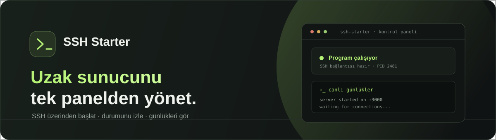
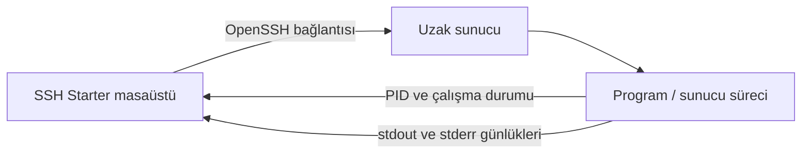

<div align="center">
  
  <br><br>
  <a href="LICENSE"></a>
  
  
  <p><b>SSH ile bağlan. Uzak programını başlat. Durumunu ve günlüklerini masaüstünden izle.</b></p>
</div>

SSH Starter, uzak Linux veya Windows makinelerdeki programları başlatıp takip etmek için hazırlanmış bir Windows masaüstü uygulamasıdır. Web sitesi veya tarayıcı açmaz. Bilgisayarındaki OpenSSH istemcisini kullanır ve Python standart kütüphanesi dışında paket gerektirmez.

## İçindekiler

- [Özellikler](#özellikler)
- [Nasıl çalışır?](#nasıl-çalışır)
- [Gereksinimler](#gereksinimler)
- [Kurulum ve başlatma](#kurulum-ve-başlatma)
- [EXE oluşturma](#exe-oluşturma)
- [İlk SSH bağlantısı](#ilk-ssh-bağlantısı)
- [Kullanım](#kullanım)
- [Pencere ve otomatik başlatma](#pencere-ve-otomatik-başlatma)
- [Ayarlar ve uzak günlükler](#ayarlar-ve-uzak-günlükler)
- [Sorun giderme](#sorun-giderme)
- [Güvenlik](#güvenlik)
- [Katkıda bulunma](#katkıda-bulunma)
- [Lisans](#lisans)

## Özellikler

- **Özel masaüstü penceresi:** Windows'un standart başlık çubuğu yerine taşınabilir, özel bir üst çubuk kullanır. Küçültme, büyütme, kapatma ve pencere boyutlandırma kontrolleri uygulamanın içindedir.
- **Özgün uygulama simgesi:** Proje için özel çizilmiş çok boyutlu ICO ve düzenlenebilir SVG simge dosyaları içerir.
- **Uzak dosyayı başlatma:** Linux programlarını ve Windows `.exe`/`.bat` dosyalarını SSH üzerinden çalıştırır.
- **Açık/kapalı durum kontrolü:** Süreci beş saniyede bir kontrol eder; çalışma durumunu ve PID'yi gösterir.
- **Canlı günlükler:** Uzak programın standart çıktı ve hata akışını uygulamadaki günlük paneline getirir.
- **Program ayarları:** Argümanları ve isteğe bağlı çalışma dizinini belirlemeyi sağlar.
- **Bağlantı testi:** Programı başlatmadan SSH erişimini doğrular.
- **Açılışta çalıştırma:** İsteğe bağlı olarak uygulamayı Windows kullanıcısı oturum açınca başlatır.
- **Yerel yapılandırma:** Pencere konumu, boyutu ve bağlantı ayarları bilgisayarda saklanır.
- **Hafif çalışma:** Python standart kütüphanesi ve OpenSSH dışında bağımlılığı yoktur.

## Nasıl çalışır?



Uygulama SSH kimlik doğrulamasını yerel OpenSSH'e bırakır. Parolayı veya özel anahtarı uygulamaya girmezsin. Program, uzak SSH kullanıcısının yetkileriyle çalışır.

| Hedef | Desteklenen dosyalar | PID ve günlük konumu |
| --- | --- | --- |
| Linux | Çalıştırma izni olan program veya betik | `/tmp/ssh-starter.pid` ve `/tmp/ssh-starter.log` |
| Windows | `.exe` veya `.bat` | Uzak kullanıcının `%TEMP%` klasörü |

## Gereksinimler

- Windows 10 veya üzeri
- Python 3.9 veya üzeri; Tkinter/Tcl bileşenleri kurulu olmalı
- Windows **OpenSSH Client** özelliği
- Uzak makinede SSH sunucusu ve hesabın için erişim izni
- Linux hedefte `sh`; Windows hedefte PowerShell

OpenSSH istemcisinin kurulu olduğunu PowerShell veya Komut İstemi'nde şu komutla kontrol edebilirsin:

```powershell
ssh -V
```

Komut bulunamazsa **Ayarlar → Uygulamalar → İsteğe bağlı özellikler → Özellik ekle** bölümünden OpenSSH Client'ı kur.

## Kurulum ve başlatma

Depoyu klonla veya GitHub'dan ZIP olarak indirip klasöre çıkart. Python kurulduktan sonra:

1. `start.bat` dosyasına çift tıkla. Uygulama `pythonw` ile konsol penceresi açmadan başlar.
2. Alternatif olarak proje klasöründe terminal aç ve çalıştır:

   ```powershell
   python main.py
   ```

Herhangi bir `pip install` adımı yoktur. `start.bat` komutu bulunamazsa Python kurulumunun PATH'e eklendiğini ve `pythonw.exe` dosyasının erişilebilir olduğunu kontrol et.

## EXE oluşturma

Python kurulu bir Windows bilgisayarda proje klasöründeki `build.bat` dosyasına çift tıkla. Betik PyInstaller'ı kurar ve konsol penceresi açmayan tek dosyalı uygulamayı oluşturur:

- Uygulama: `dist/SSHStarter.exe`
- Lisans bildirimi: `dist/LICENSE`

Oluşturulan EXE'yi Python kurulu olmayan Windows bilgisayarlarda çalıştırabilirsin. Uzak sunucu bağlantısı için hedef bilgisayarda OpenSSH Client kurulu olmalıdır. Güvenlik yazılımları PyInstaller ile paketlenen yeni EXE'leri ilk çalıştırmada inceleyebilir. EXE'yi GitHub'da yayımlarken kaynak kodunu, `LICENSE` dosyasını ve kullanım talimatlarını da depoda tut.

## İlk SSH bağlantısı

Önce bağlantıyı uygulama dışında doğrulaman yararlı olur:

```powershell
ssh kullanici@sunucu-adresi
```

SSH anahtarını `ssh-agent` içine yükleyebilir veya `%USERPROFILE%\.ssh\config` dosyasında bir takma ad tanımlayabilirsin. Örnek:

```sshconfig
Host uygulama-sunucum
    HostName 192.0.2.10
    User deploy
    Port 2222
    IdentityFile ~/.ssh/id_ed25519
```

Sonra uygulamadaki host alanına `uygulama-sunucum` yaz. Kullanıcı adı ve portu doğrudan arayüzden de verebilirsin. Port boş bırakılırsa SSH'in standart 22 portu kullanılır; OpenSSH yapılandırmasındaki host ayarları da geçerlidir.

## Kullanım

1. **Host adı veya IP** alanına SSH takma adını ya da sunucu adresini gir.
2. Gerekirse **Kullanıcı adı** ve **SSH portu** değerlerini yaz.
3. **Hedef sistem** listesinden `Linux` veya `Windows` seç.
4. **Dosya yolu** alanına uzak programın tam yolunu gir. Örnekler:
   - Linux: `/opt/my-app/server`
   - Windows: `C:\Apps\my-app\server.exe`
   - Windows batch: `C:\Apps\my-app\start-server.bat`
5. İstersen program **argümanlarını** ve **çalışma dizinini** gir.
6. **Ayarları kaydet** düğmesine bas.
7. **SSH bağlantısını test et** ile erişimi doğrula.
8. **Başlat** düğmesine bas. Durum alanı açık/kapalı bilgisi ile PID'yi; günlük paneli uzak programın çıktısını gösterir.
9. **Durdur** düğmesi uygulamanın izlediği süreci kapatır.

Linux'ta dosyanın çalıştırma izni bulunmalıdır. Gerekirse uzak sunucuda `chmod +x /opt/my-app/server` komutunu çalıştır. Çalışma dizini boşsa program uzak SSH oturumunun varsayılan dizininde başlatılır.

## Pencere ve otomatik başlatma

Özel üst çubuktan pencereyi taşıyabilir, küçültüp büyütebilir ve kapatabilirsin. Kenar ve köşelerden pencere boyutu ayarlanabilir; son boyut ve konum sonraki açılış için kaydedilir.

**Bilgisayar açılınca uygulamayı başlat** ayarı geçerli Windows hesabının oturum açma başlangıcına SSH Starter'ı ekler veya kaldırır. Bu ayar yalnızca masaüstü uygulamasını başlatır; uzak programı kendiliğinden çalıştırmaz. Uzak programı başlatmak için **Başlat** düğmesine basmalısın.

## Ayarlar ve uzak günlükler

- Yerel uygulama ayarları: `%APPDATA%\SSHStarter\settings.json`
- Linux uzak PID ve günlük: `/tmp/ssh-starter.pid`, `/tmp/ssh-starter.log`
- Windows uzak PID ve günlük: uzak kullanıcının `%TEMP%` klasöründeki SSH Starter dosyaları

Yerel ayar dosyası SSH parolası veya özel anahtar içermez. `.gitignore` bu ayarları ve geçici Python dosyalarını depoya eklenmekten korur.

Uygulama son 100 uzak günlük satırını alıp yeni çıktıları panelde gösterir. Program günlüklerini kendi dosyasına yazıyorsa, o dosyanın içeriği stdout/stderr'e yönlendirilmediği sürece uygulamada görünmez.

## Sorun giderme

### Pencere açılmıyor veya kapanıyor

- Terminalden `python main.py` çalıştırıp ekrana gelen hata metnini incele.
- Python kurulumunda Tkinter/Tcl bileşenlerinin yer aldığını kontrol et.
- `start.bat` kullanıyorsan `pythonw.exe` dosyasının PATH üzerinde olduğundan emin ol.

### SSH bağlantısı kurulamıyor

- Aynı host ile terminalden `ssh kullanici@host` komutunu çalıştır.
- OpenSSH Client'ın kurulu olduğunu ve `ssh` komutunun PATH üzerinde bulunduğunu doğrula.
- Host, kullanıcı, port, SSH anahtarı, `ssh-agent` ve uzak makinenin güvenlik duvarı ayarlarını kontrol et.
- Sunucunun parmak izi ilk bağlantıda sorulursa, yalnızca sunucunun kimliğini doğruladıktan sonra SSH istemcisindeki onayı ver.

### Dosya başlıyor ama durum “kapalı” görünüyor

Uygulama başlattığı uzak PID'yi takip eder. Başlatılan program hızlıca kapanırsa, uzak makine yeniden başlarsa veya uzak PID dosyası silinirse durum kapalı görünür. Windows'ta `.bat` dosyaları `cmd.exe` üzerinden başlatılır; **Durdur** komutu izlenen süreci ve çocuk süreç ağacını kapatır.

### Günlükler görünmüyor

Programın stdout veya stderr akışına yazdığını ve uzak kullanıcının geçici günlük dosyalarını oluşturma izni olduğunu kontrol et. Program kendi günlük dosyasına yazıyorsa dosyanın yolunu programın kendi ayarlarından incele.

## Güvenlik

- SSH Starter uzak programı SSH hesabının izinleriyle çalıştırır. Yalnızca güvendiğin sunuculara bağlan.
- Parolanı, özel anahtarını veya erişim belirtecini uygulamaya ya da Git deposuna ekleme. OpenSSH yapılandırması ve `ssh-agent` kullan.
- Başlatmadan önce host, dosya yolu ve argümanları kontrol et.
- Uygulama her hedefte tek PID/günlük dosyasıyla bir süreç izler. Aynı uzak kullanıcı ve hedefte birden çok SSH Starter örneğini eşzamanlı çalıştırma.

## Katkıda bulunma

Hata bildirimleri ve pull request'ler memnuniyetle karşılanır. Hata bildirirken Windows/Python sürümünü, hata mesajını ve yeniden oluşturma adımlarını ekle. Değişiklik önerilerinde kullanıcıya görünen davranışı ve doğrulama adımlarını belirt.

## Lisans

Bu proje MIT Lisansı ile yayımlanır. Yeniden kullanım, değiştirme ve dağıtım koşulları için [`LICENSE`](LICENSE) dosyasını incele.
